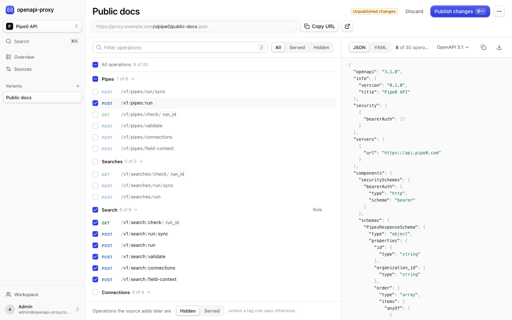

# openapi-proxy

**Serve filtered versions of your OpenAPI document at stable URLs.**

Your backend generates one OpenAPI document for everything it does. Your public docs, your SDK generator and your partners each need a different part of it. openapi-proxy sits in between: point it at the document (or at several, to merge them), pick what each consumer should see, and hand each of them a URL that always reflects the current source.

<picture>
  <source media="(prefers-color-scheme: dark)" srcset="docs/editor-dark.png">
  
</picture>

[](https://deploy.workers.cloudflare.com/?url=https://github.com/pipe-0/openapi-proxy)

## Why

Frameworks generate **one** OpenAPI file for the whole backend, but consumers need **different subsets**: public docs should not list internal endpoints, an SDK should not bundle admin operations, a partner should only see partner routes. The usual answer is a batch pipeline (Redocly decorators, openapi-format, Speakeasy transforms): config files, a CI job, and regenerated artifacts every time the source changes.

openapi-proxy treats it as infrastructure instead. It fetches your document, applies a selection you made in a UI, and serves the result. When the source changes, the served documents change with it.

- **Pick in a UI, not in a config file.** Check operations or whole tags. The document that will be served is on screen while you do, and nothing goes live until you publish.
- **Merge several documents into one.** An API made of several services gets one document. Schemas that share a name but not a meaning are told apart, and you are shown what the merge did.
- **The version each tool needs.** A variant can be served as OpenAPI 3.0 or 3.1, converted from what your source has. What 3.0 cannot express is listed.
- **Correct pruning.** The output contains the kept operations plus exactly what they reference: schemas, parameters, responses, request bodies, headers, examples, links, callbacks, path items, security schemes, `discriminator.mapping` targets, and the subtypes of a polymorphic schema that are only implied through `allOf`. Circular references are fine. Every output is a valid document that stands on its own.
- **Delivery does not fail.** If the source goes down or drops an endpoint you selected, consumers keep getting a valid document, minus what is gone. Changes in the source are shown to you in the UI, not to your consumers as an error.
- **Current when it is read.** A copy older than the check interval is never handed out on trust: the request that notices checks your source first. The build that runs once a day gets today's document, not the one from its previous run.
- **Cheap to keep fresh.** A check stops at the first step that settles the question: an optional version endpoint, then a conditional request, then a download. Consumers get strong ETags and 304s.
- **You hear about changes.** When the source gains, changes or loses operations, the people in your workspace get an email saying which, and which variants serve them. "Changed" includes a change that arrives through a schema.
- **Private sources.** If the full document sits behind authentication (it probably should), the proxy fetches it with request headers you provide, stored encrypted.
- **For scripts and agents.** Everything the app does is an HTTP API with tokens, and an MCP endpoint at `/mcp` offers the same as tools.

## How it works

```
consumer (docs site, SDK generator, curl)
        │  GET /v/pipe0/public-docs.json
        ▼
   openapi-proxy (one Cloudflare Worker + D1)
        │  serves the stored result; checks the source first when the copy is due
        ▼
   your OpenAPI document
```

Three concepts:

- A **workspace** is the people who share the projects. Signing in gives you one; you invite colleagues into it by email. A person is in exactly one.
- A **project** is one API as its readers know it: one OpenAPI document fetched from a URL, or several **sources** merged into one. It has a name and a short URL prefix (`pipe0`).
- A **variant** is a named selection of the project's operations, served at `/v/<project>/<variant>`, optionally converted to another OpenAPI version. A project has as many variants as it has audiences.

## Quickstart

### Deploy to Cloudflare

1. Click **Deploy to Cloudflare** above. Cloudflare copies this repository into your account, creates the D1 database, asks for the secrets below, runs the migrations and deploys the Worker.
2. Open the Worker's URL and sign in.
3. Paste the URL of your OpenAPI document, pick operations, name the variant, copy its URL.

| Secret                                      | What it is                                                                                       |
| ------------------------------------------- | ------------------------------------------------------------------------------------------------ |
| `AUTH_SECRET`                               | Required. A random string (`openssl rand -hex 32`). Signs sessions, encrypts source credentials. |
| `GOOGLE_CLIENT_ID` + `GOOGLE_CLIENT_SECRET` | Sign in with Google. See [Signing in](#signing-in).                                              |
| `ADMIN_PASSWORD`                            | Instead of, or next to, Google: one built-in admin with this password. Make it long.             |

You need Google, the password, or both.

From the command line:

```sh
git clone https://github.com/pipe-0/openapi-proxy && cd openapi-proxy
pnpm install
pnpm exec wrangler d1 create openapi-proxy
printf 'OPENAPI_PROXY_D1_DATABASE_ID=<the printed id>\n' > .env.deploy   # gitignored
pnpm run deploy                                                          # builds, migrates, deploys
pnpm exec wrangler secret put AUTH_SECRET                                # then the others
```

Add `OPENAPI_PROXY_DOMAIN=proxy.example.com` to `.env.deploy` to serve on a domain of yours (it has to be a zone in the same Cloudflare account).

### Run locally

```sh
git clone https://github.com/pipe-0/openapi-proxy && cd openapi-proxy
pnpm install
cp .env.example .env     # password sign-in, password: admin
pnpm dev                 # http://localhost:7732, no Cloudflare account needed
```

The example secrets only work on localhost. A deployed instance that still has them refuses to sign anyone in.

## Signing in

**Google.** Create an OAuth client of type "Web application" in the [Google Cloud console](https://console.cloud.google.com/apis/credentials), register the redirect URI `https://<your origin>/api/auth/callback/google` (locally `http://localhost:7732/api/auth/callback/google`), and set its ID and secret. Whoever signs in gets a user and an organization of their own; their projects are invisible to everyone else.

**Who may sign in.** With Google configured and nothing else, anyone with a Google account can sign in and use your instance. That is what a public service wants and what a private instance does not: set `ALLOWED_EMAILS` to a comma-separated list of addresses and domains (`ada@example.com, example.org`) to close it.

**Admin password.** Setting `ADMIN_PASSWORD` adds a second way in: a single built-in admin. It exists for local development and for self-hosting without creating a Google client. Five wrong attempts lock it for 30 seconds.

**Colleagues.** Anyone in a workspace can invite others by email address, from the Workspace page. The invited person signs in with that address and lands in your workspace; an invitation also lets them in past `ALLOWED_EMAILS`. With email set up the invitation is sent for you, otherwise you get a link to pass on. The person who created the workspace can remove people.

Sessions, users and organizations are handled by [better-auth](https://better-auth.com) and stored in D1.

## Selecting operations

In the editor a checked operation is served and an unchecked one is not. That is all the checkbox ever means. Two things go beyond the operations that exist today:

- **Checking a whole tag creates a rule.** "Everything tagged `public`, now and later." Operations added to that tag in the future are covered without you doing anything. A rule can be turned back into a fixed list.
- **One switch decides the rest.** Operations the source adds later, that no rule covers, are either _hidden_ (the safe default: nothing reaches your public docs by accident) or _served_.

Operations are identified by method and path, so `operationId`s are not required (many generated documents have none). Webhooks are operations too and follow the same rules: a webhook you did not select is not served, and neither are the schemas only it used.

What gets stored is the selection, not a copy of the document:

```jsonc
{
  "mode": "include", // later additions are hidden; "exclude": they are served
  "operations": ["GET /v1/books", "POST webhook:bookAdded"],
  "tags": ["public"]
}
```

## When the source changes

The proxy re-reads your document, so it can tell you what moved:

| In the source                   | What is served                                   | What you see                                                      |
| ------------------------------- | ------------------------------------------------ | ----------------------------------------------------------------- |
| A selected operation disappears | The rest. It is served again if it comes back.   | A notice in the editor, and an email                              |
| New operations appear           | Hidden or served, as the switch and rules decide | A "new" marker on the variant, and an email                       |
| An operation changes            | The new version                                  | An email, if a variant serves it (or always, if you ask for that) |
| It is unreachable or invalid    | The last good copy                               | "Check failed" on the project, with the reason                    |

Emails go to the address each person signed in with, and each person chooses how much they want: nothing, new operations plus anything that touches what a variant serves, or every change in the source. A change counts per operation and includes what the operation references, so a field added to a schema is reported for the operations that use that schema, and for no others.

The source is also checked once an hour whether or not anyone reads a variant, so you hear about a new operation before your next docs build, not after it.

Email goes out through [Cloudflare Email Sending](https://developers.cloudflare.com/email-service/), from the account the Worker already runs in: set up a sending domain there, then set `CLOUDFLARE_EMAIL_TOKEN` (an API token that may send email), `CLOUDFLARE_EMAIL_ACCOUNT_ID` and `EMAIL_FROM`, and `APP_URL` so that emails can link back. Without them nothing is sent and everything else works the same.

## Serving

```
GET /v/<project>/<variant>         format from the Accept header, JSON by default
GET /v/<project>/<variant>.json
GET /v/<project>/<variant>.yaml
```

| Response header               | Value                                                                                |
| ----------------------------- | ------------------------------------------------------------------------------------ |
| `ETag`                        | Strong. Changes exactly when the bytes do: new source, new selection.                |
| `Cache-Control`               | `public, max-age=60, stale-while-revalidate=300` (`no-cache` at interval 0)          |
| `X-Proxy-Source-Status`       | `fresh`, `stale` (a check is still running) or `stale-error` (the source is failing) |
| `Access-Control-Allow-Origin` | `*`, because docs renderers and generators fetch from other origins                  |

Conditional requests (`If-None-Match`) and `HEAD` are supported. JSON output mirrors the source's formatting: a minified source is served minified, an indented one indented.

Each format of each variant is rendered once per change and stored, so a request is normally one small database read plus the response. On a custom domain, responses are also kept in Cloudflare's edge cache.

Variant URLs are public by design. If you rely on a URL being unguessable, the dice button next to the slug generates one.

## Staying in sync

Each project has a **check interval** (5 minutes by default). Until it has passed, variants are served without looking at the source. After that, the next request checks the source before it is answered, so what it gets is current.

- Exactly one request does the checking, however many arrive. The others wait for its result, unless the copy only just crossed the interval, in which case they are answered from it at once.
- Nobody waits longer than 5 seconds. A slower source is checked in the background and the request is answered from the copy.
- A source that is failing is never waited on. Requests get the last good copy, and one retry runs every 30 seconds until it is back.
- A reader that needs the current document right now sends `Cache-Control: no-cache` (or `max-age=<seconds>`). That is honored down to once every 10 seconds, so it cannot be used to hammer your source.

```sh
# In a deploy pipeline, right after the API went live:
curl -H "Cache-Control: no-cache" https://proxy.example.com/v/pipe0/sdk.json
```

A check stops at the first step that settles the question:

1. **Version endpoint** (optional). Any URL of yours that says which version is live. It is asked with `HEAD`, then `GET`, and may answer with a header (`X-API-Version`, `ETag`, `Last-Modified`), a small JSON body (`{"version": "..."}`, `info.version`) or plain text such as a commit hash. Same answer as last time: nothing is downloaded. It can be the document's own URL if that answers `HEAD` with such a header.
2. **Conditional request** using the `ETag` or `Last-Modified` your server sent with the document. A `304` transfers no body.
3. **Download.** If the bytes are identical to the stored copy, nothing changes downstream and every variant keeps its ETag.

If your server sends an `ETag` with the document, step 2 already makes checks free and there is nothing to set up; most frameworks have a one-line middleware for it. The Sources page says which of the three applies to each document.

The version endpoint must change whenever the document does. A deploy id or commit hash is a better choice than a version number nobody remembers to bump. The proxy does not take that on trust: it compares the document itself at least once a day, and an endpoint that is caught reporting one version for two different documents is no longer used until you save it again.

## Private sources

The full document often should not be public, since it describes everything. Give a source request headers (typically `Authorization`) and the proxy sends them with every fetch. They are encrypted before they are stored, are never returned by the API, and are only ever sent to the source's own origin, not to wherever a redirect points.

## Merging documents

A project can be assembled from up to 10 documents: add more when you connect ("Merge several documents into one"), or later from the project's Sources page. This is for independent APIs that readers see as one, not for one API split across files with `$ref`.

A merge runs again every time a source changes, so it follows fixed rules instead of asking:

- **The first document is the main one.** Its `info` and `servers` describe the merged API. Other documents' servers are not carried over, so an internal address does not leak into a public document.
- **Every operation keeps its security.** A document's default `security` is written onto its operations where the main document has a different one.
- **The same operation in two documents:** the earlier one is kept, and the Sources page lists what was left out.
- **The same name for two different things:** identical components are shared. Different ones are renamed after their document (`Error` becomes `BillingError`), with every reference following.
- **A path prefix per document**, for a service mounted under the main API (`/invoices` becomes `/billing/invoices`).
- **Mixed versions:** a 3.0 document is converted to 3.1 before it is merged with newer ones.

If one source is down, its last good copy stays in the merge and the others keep updating.

## OpenAPI versions

A variant is served in the version of its source unless you choose another: 3.0 or 3.1. Going up loses nothing. Going down translates what has an equivalent (`type: [T, "null"]` to `nullable`, `const` to `enum`, `examples` to `example`, and so on) and removes what has none (`patternProperties`, tuples, `if`/`then`/`else`); the editor lists exactly what was left out. A single source served in its own version is not rewritten at all.

## API and MCP

Create a token on the Workspace page and send it as `Authorization: Bearer oap_...`. The routes the app itself uses are the API: `/api/projects`, `/api/projects/{id}/sources`, `/api/variants`. Errors are `{ code, error }`.

`/mcp` is a Model Context Protocol endpoint (Streamable HTTP, stateless) that offers the same operations as tools, with the same token:

```sh
claude mcp add --transport http openapi-proxy https://<your instance>/mcp \
  --header "Authorization: Bearer oap_..."
```

The docs at `/docs/api-and-mcp` on any instance list the routes, the tools and the client configuration.

## @openapi-proxy/core

The engine is a separate MIT-licensed package with one dependency (`yaml`) and no I/O. The Worker and the browser preview run the same code, and you can use it in your own pipelines:

```ts
import { assembleDocument, buildVariant, parseSpec, serialize } from "@openapi-proxy/core";

const { doc } = assembleDocument([
  { name: "Core API", doc: parseSpec(coreText).doc },
  { name: "Billing API", doc: parseSpec(billingText).doc, pathPrefix: "/billing" },
]);
const variant = buildVariant(doc, {
  selection: { mode: "include", operations: ["GET /v1/books"], tags: ["public"] },
  version: "3.0",
});
const yaml = serialize(variant.doc, "yaml");
```

It is laid out as a short pipeline of pure transforms (parse, convert, merge, select, convert, serialize), and a version conversion is a list of small named steps. What it guarantees, each enforced by tests with an independent validator as a judge: the output is valid and self-contained, the input is never mutated, key order is preserved. See [packages/core](packages/core).

## Limits

- Source documents must be **self-contained**. External or multi-file `$ref`s are rejected when the project is created, with the offending references listed. Bundle first, for example with `redocly bundle`.
- A project's sources together up to **5 MB**, and up to 10 of them. Worker memory and CPU are the constraint; storage is compressed. A document can be nested up to 200 levels and use up to 5,000 YAML aliases; real documents are nowhere near either.
- **OpenAPI 3.0, 3.1 and 3.2.** Swagger 2.0 documents are rejected with a message saying so. Conversion covers 3.0 and 3.1.
- Up to 100 projects per workspace, 100 variants per project, 50 people.
- 300 API requests per workspace and minute, where a request that fetches a source counts as ten. Change the number in `wrangler.jsonc` (`ratelimits`). Reading served documents under `/v/` is not counted.
- The hourly check of sources that nobody has read lately does as much as one Worker invocation may: a handful of projects per hour on Cloudflare's free plan, 40 on a paid one. Readers' requests always check for themselves, whatever the plan.
- **No rewriting of content.** Descriptions, examples and names are served as your source has them (apart from a rename a merge has to make).

## Running it as a service

Everything above is the same whether you run it for yourself or for others. A few settings exist for the second case:

- `DEFAULT_PLAN=free` puts every new workspace on the free plan: 3 OpenAPI documents and 15 variants. Limits apply when something is created, never to serving. A workspace is moved to Pro by hand: `UPDATE organization SET plan = 'pro' WHERE id = '...'`.
- `PUBLIC_SITE=true` serves a landing page, a blog, and about, terms and privacy pages. Without it, `/` goes straight to the app. The texts in `src/web/content/legal` and the landing page describe the hosted service at openapi-proxy.app; replace them before you turn this on for a service of your own.
- `CONTACT_EMAIL` is where "ask about Pro" points.

When deploying from the command line, put them into `.env.deploy` with the prefix `OPENAPI_PROXY_` (`OPENAPI_PROXY_DEFAULT_PLAN=free`); the same goes for `APP_URL`, `EMAIL_FROM`, `CLOUDFLARE_EMAIL_ACCOUNT_ID` and `ALLOWED_EMAILS`. Secrets such as `CLOUDFLARE_EMAIL_TOKEN` are set with `wrangler secret put`.

## Roadmap

- Swagger 2.0 sources (one more conversion step in the engine)
- OAuth sign-in for MCP clients that cannot send a token header
- Billing, and custom domains for variants; see [ARCHITECTURE.md](ARCHITECTURE.md) for where each of these attaches

## Development

Tool versions are pinned in [`mise.toml`](mise.toml) (Node 24, pnpm 11): `mise install`, or bring your own.

```sh
pnpm install
pnpm dev           # Vite + the Worker in workerd + a local D1 database, on :7732
pnpm check         # lint, typecheck, unit and integration tests
pnpm test:e2e      # the product journey in a real browser, fully offline
```

The repository root is the deployable app: `src/server` is the API, the public documents and the hourly check; `src/web` is the Worker's entry and every page (React on TanStack Start). [`packages/core`](packages/core) is the filter engine, published to npm.

Using it: the docs at `/docs` of any instance (source in `src/web/content/docs`). Changing it: [CONTRIBUTING.md](CONTRIBUTING.md), [ARCHITECTURE.md](ARCHITECTURE.md), [docs/flows.md](docs/flows.md) for the interaction design, [docs/design.md](docs/design.md) for the design system, [SECURITY.md](SECURITY.md).

## License

- [`packages/core`](packages/core/LICENSE): **MIT**
- Everything else: **[FSL-1.1-MIT](LICENSE.md)**. Free to use, self-host and modify; you may not offer it as a competing hosted service. Each release becomes MIT two years after it is published.
