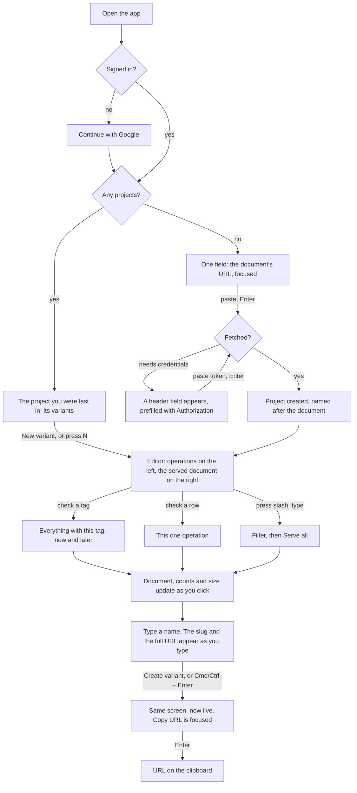

# From a URL to a served variant

Every interaction needed to publish a filtered document, and what the app does at each step so the path stays short. The target is under two minutes from signing in to a copied URL, and no decision that the app could have made for you.

## Interactions on the shortest path

| Step              | What you do                             | What you do not have to do                                           |
| ----------------- | --------------------------------------- | -------------------------------------------------------------------- |
| Sign in           | One click, plus Google's own            | Create an account or an organization                                 |
| Point at the spec | Paste the URL, Enter                    | Create or name a project, choose its URL prefix (derived, editable)  |
| Select            | One click per tag, or one per operation | Think about schemas: everything referenced comes along, nothing else |
| Name              | Type a name                             | Write a slug, check that it is free, pick a format                   |
| Publish           | Enter                                   | Configure caching, check schedules or ETags                          |
| Use               | Enter (copies the URL)                  |                                                                      |

## What changed from the first design, and why

- **Creating and editing are one screen.** There used to be a builder with one layout and a detail page with another. Now the editor is the editor: a new variant is the same screen with a name to fill in and a Create button where Publish will be.
- **A checkbox means "served", always.** In the old exclude mode a checked box meant "removed". Now the mode is a separate switch that only decides what happens to operations the source adds later, and switching it changes nothing that is currently served.
- **The result is on screen.** The document used to be behind a button, with a few numbers standing in for it. It now sits next to the list and updates as you click, with the same numbers above it.
- **Changes are staged.** Edits to a live variant used to raise a floating bar. Now the header says "Unpublished changes", Publish is the main button, and leaving asks first.
- **There is navigation.** A sidebar shows the project and its variants on every screen, so moving between variants is one click, and `⌘K` reaches anything by name.
- **The list is a list.** An operation is its method and its path. Descriptions moved into a tooltip, counts that were shown twice are shown once, and grouping follows the document (by tag where it has tags, by path where it does not) instead of being a setting.
- **Status is a word.** Colored dots in front of text are gone. A project is "In sync", "Idle" or "Check failed", in a chip.

## Choices made on your behalf

- **Project name and URL prefix** come from the document's title ("Pipe0 API" becomes `pipe0`). Both can be changed under Source.
- **Formats.** Every variant is available as JSON and YAML. The extension or the `Accept` header decides.
- **Later additions are hidden** unless you say otherwise, because the safe failure is an operation missing from public docs, not an internal one appearing in them.
- **Checking a tag creates a rule**, because that is almost always what was meant. Unchecking a single operation under a rule quietly turns the rule into a fixed list of the others.
- **Freshness.** A served document is at most five minutes behind the source, because an older copy is checked before it is handed out. Adjustable per project, never required.

## More than one document, more than one version

- **Merging** starts where connecting does: under the URL field, "Merge several documents into one" adds fields for the others. A project that exists gets another document in its settings. Either way there is nothing to configure: the rules are fixed, and the page says afterwards what the merge did.
- **A path prefix** is the one setting a merged document usually needs, and it sits with that document.
- **The version** is not a setting of a variant. Every variant is served in each OpenAPI version, at a path of its own, and the plain URL serves the version the documents have. There is no setting: one way to choose a version (the URL) is easier to explain than a URL plus a setting that changes what it means. The switch next to JSON and YAML picks which one the preview shows and says where each is served, and the URL above follows it, so what is on screen is always what the URL to copy serves.
- **Who can read a variant** is next to its URL, because that is the question the URL raises. It holds from the moment it is chosen (it is not part of the draft), making one public asks first, and a private one offers the key its readers need right there. A workspace decides what new variants start as, so that a team with internal APIs never has one public by accident.

## Working with others

- **Inviting** is one field: an email address, on the Workspace page. With email set up, the invitation is sent; without, you get a link to pass on.
- **Joining** is one click after signing in with the invited address. There is nothing to choose, because a person is in exactly one workspace.
- **Hearing about changes** needs no setup. Everyone gets an email when a source gains an operation, or when something a variant serves changes or disappears, and can turn that up (everything in the source) or off.

## Coming back

- **"Is everything all right"** is answered by the navigation, on every page: each variant says whether the source has moved since you last looked (new operations, or selected ones that are gone), and Project settings is marked when a check failed. A project opens on its settings, where its documents come first, with their status in a word. There is no separate overview: it listed the variants a second time. Each variant has an icon in the navigation, picked next to its name in the editor and saved as it is picked: a variant is made for an audience, and a picture tells audiences apart faster than a name does.
- **Source changes** are reported in the editor. An operation that disappeared needs no decision: it stays selected and is served again if it comes back. New ones get a filter that shows just them, and "Mark as reviewed".
- **A session that ended** while the app was open sends you to sign in and then back to the page you were on.

## Keyboard

| Key                         | Where         | Does                                |
| --------------------------- | ------------- | ----------------------------------- |
| `Cmd/Ctrl` + `K`            | Anywhere      | Command menu: any variant or action |
| `N`                         | Anywhere      | New variant in the current project  |
| `/`                         | Editor        | Focus the operation filter          |
| `↓` `↑`                     | Editor        | Walk the list                       |
| `Space`                     | Editor        | Serve or hide the focused operation |
| `Esc`                       | In the filter | Clear it                            |
| `Cmd/Ctrl` + `Enter` or `S` | Editor        | Create, or publish changes          |
| `←` `→`                     | Any switch    | Move between its options            |
