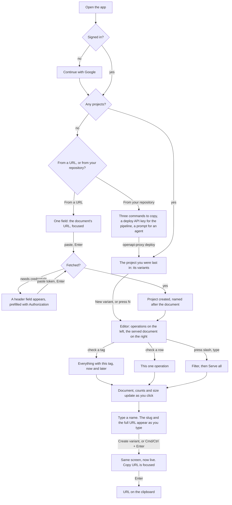

# From a URL to a served variant

Every interaction needed to publish a filtered document, and what the app does at each step so the path stays short. The target is under two minutes from signing in to a copied URL, and no decision that the app could have made for you.

The same editor runs in two places: in the app, over a project the service holds, and on localhost (`openapi-proxy dev`), over an `openapi-proxy.yaml`. Everything below about selecting holds for both. What differs is what a save does (publish, or write the file) and what only a service has (keys, credentials, checks), which the local editor leaves out.

## Interactions on the shortest path

| Step              | What you do                             | What you do not have to do                                                          |
| ----------------- | --------------------------------------- | ----------------------------------------------------------------------------------- |
| Sign in           | One click, plus Google's own            | Create an account or an organization                                                |
| Point at the spec | Paste the URL, Enter                    | Create or name a project, choose its URL prefix (derived, editable until it exists) |
| Select            | One click per tag, or one per operation | Think about schemas: everything referenced comes along, nothing else                |
| Name              | Type a name                             | Write a slug, check that it is free, pick a format                                  |
| Publish           | Enter                                   | Configure caching, check schedules or ETags                                         |
| Use               | Enter (copies the URL)                  |                                                                                     |

## What changed from the first design, and why

- **Creating and editing are one screen.** There used to be a builder with one layout and a detail page with another. Now the editor is the editor: a new variant is the same screen with a name to fill in and a Create button where Publish will be.
- **A checkbox means "served", always.** A checked box once meant "removed" for variants that listed what to leave out. Now what happens to operations the source adds later is a switch of its own at the foot of the list, and switching it changes nothing that is currently served.
- **The result is on screen.** The document used to be behind a button, with a few numbers standing in for it. It now sits next to the list and updates as you click, with the same numbers above it.
- **Changes are staged.** Edits to a live variant used to raise a floating bar. Now the header says "Unpublished changes", Publish is the main button, and leaving asks first.
- **There is navigation.** A sidebar shows the project and its variants on every screen, so moving between variants is one click, and `⌘K` reaches anything by name.
- **The list is a list.** An operation is its method and its path. Descriptions moved into a tooltip, counts that were shown twice are shown once, and grouping follows the document (by tag where it has tags, by path where it does not) instead of being a setting.
- **Status is a word.** Colored dots in front of text are gone. A project that follows a URL is "In sync", "Due" or "Check failed", in a chip. One whose documents are uploaded has no status: nothing is checked.

## Choices made on your behalf

- **Project name and URL prefix** come from the document's title ("Pipe0 API" becomes `pipe0`). The prefix can be changed in the field below the URL before connecting. After that it is what the project is known by, in the app's addresses, in every served URL and in a definition file, and it stays. The name can be changed in Project settings.
- **Formats.** Every variant is available as JSON and YAML. The extension or the `Accept` header decides.
- **Later additions are hidden** unless you say otherwise, because the safe failure is an operation missing from public docs, not an internal one appearing in them.
- **Checking a tag creates a rule**, because that is almost always what was meant. Unchecking a single operation under a rule keeps the rule and leaves out that one operation: "this whole tag, except these two" stays true when the tag grows.
- **Following.** A URL connected in the app is followed: the service reads it again every five minutes where the source can answer "nothing new" without sending the document, and hourly where it cannot. There is nothing to set, and "Check now" is there for the moment after a deploy.
- **Who may read a new variant** is what its project says, and then what its workspace says. A variant only states it when someone chooses to.

## More than one document, more than one version

- **Merging** starts where connecting does: under the URL field, "Merge several documents into one" adds fields for the others. A project that exists gets another document in its settings. Either way there is nothing to configure: the rules are fixed, and the page says afterwards what the merge did.
- **A path prefix** is the one setting a merged document usually needs, and it sits with that document.
- **The version** is not a setting of a variant. Every variant of a 3.0 or 3.1 document is served in both, each at a path of its own, and the plain URL serves the version the documents have. There is no setting: one way to choose a version (the URL) is easier to explain than a URL plus a setting that changes what it means. The switch next to JSON and YAML picks which one the preview shows and says where each is served, and the URL above follows it, so what is on screen is always what the URL to copy serves.
- **Who can read a variant** is next to its URL, because that is the question the URL raises. The control has three answers: public, private, and the default, which is what the project or the workspace says and names what that comes to at the moment. It holds from the moment it is chosen (it is not part of the draft), making one public asks first, and a private one offers the key its readers need right there. A workspace and a project each say what their variants are unless they say otherwise, so that a team with internal APIs never has one public by accident, and changing the workspace's answer says how many variants it changes.
- **What stands at the top of a document** (title, description, servers) works the same way: a project states it once in its settings, a variant overrides one field at a time, and an empty field shows what it inherits as its placeholder.

## A project in a repository

- **Starting there** is the second choice on the connect screen, of equal weight: the three commands (`init`, `dev`, `deploy`), a button that makes a deploy API key and shows the workflow that uses it, and a prompt to hand to a coding agent.
- **Moving there** takes nothing but a copy: "View as file" in Project settings and in a variant's menu shows the project as the exact `openapi-proxy.yaml` it comes to, with the steps to put it into a repository.
- **A deployed project is read in the app, not edited.** Its variants say "Deployed from a file", the controls are off, and one notice says when it was deployed, with which key and from which commit. Two places to edit the same thing would drift apart, so there is one.
- **Taking it back** is one button on that notice, "Edit in the app instead". It holds until the file is deployed again: a deploy is the source of truth, and the app asks for no confirmation on its behalf.
- **The local editor saves into the file**, where the selection changed and nowhere else: comments, order and spacing stay as their author wrote them. If the file changed on disk while there were unsaved changes on screen, the page says so and keeps both until someone decides.

## Working with others

- **Inviting** is one field: an email address, on the Workspace page. With email set up, the invitation is sent; without, you get a link to pass on.
- **Joining** is one click after signing in with the invited address. There is nothing to choose, because a person is in exactly one workspace.
- **Hearing about changes** needs no setup. Everyone gets an email when a source gains an operation, or when something a variant serves changes or disappears, and can turn that up (everything in the source) or off.

## Coming back

- **"Is everything all right"** is answered by the navigation, on every page: a variant is marked when its selection names operations the document does not have, and Project settings is marked when a check failed. A project opens on its settings, where its documents come first, with their status in a word. There is no separate overview: it listed the variants a second time. Each variant has an icon in the navigation, picked next to its name in the editor and saved as it is picked: a variant is made for an audience, and a picture tells audiences apart faster than a name does.
- **Source changes** need no decision. An operation that disappeared stays selected and is served again if it comes back; the editor lists such names in a notice for as long as there are any, and there is nothing to dismiss. New ones are served or hidden from the moment they appear, as the variant says for operations added later, and the email about the change names them.
- **A session that ended** while the app was open sends you to sign in and then back to the page you were on.

## Keyboard

| Key                         | Where         | Does                                                   |
| --------------------------- | ------------- | ------------------------------------------------------ |
| `Cmd/Ctrl` + `K`            | Anywhere      | Command menu: any variant or action                    |
| `N`                         | Anywhere      | New variant in the current project                     |
| `/`                         | Editor        | Focus the operation filter                             |
| `↓` `↑`                     | Editor        | Walk the list                                          |
| `Space`                     | Editor        | Serve or hide the focused operation                    |
| `Esc`                       | In the filter | Clear it                                               |
| `Cmd/Ctrl` + `Enter` or `S` | Editor        | Create, or publish changes (locally: save to the file) |
| `←` `→`                     | Any switch    | Move between its options                               |
